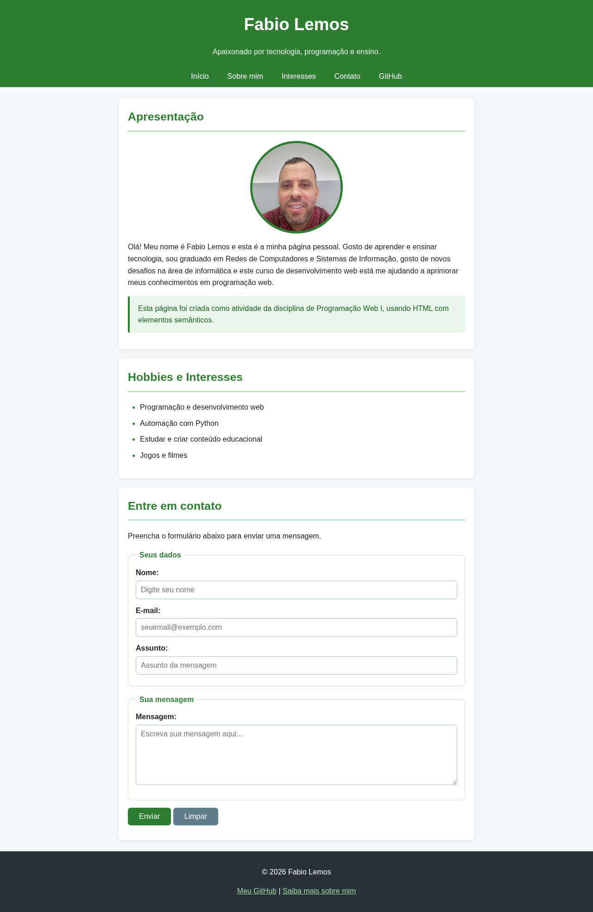

# Página Pessoal — Programação Web I

Atividade de estilização de página pessoal com **CSS externo**, preservando a estrutura semântica em HTML.

## Arquivos

- `index.html`: apresentação, interesses e formulário de contato.
- `sobre.html`: formação, experiência e objetivos.
- `css/style.css`: folha de estilos utilizada nas duas páginas.
- `img/3.jpeg`: foto de perfil.
- `screenshot.png`: captura da página com CSS aplicado.

## Recursos de CSS utilizados

Seletores de elementos, de classe (`.texto-destaque`, `.foto-perfil`) e de ID; cores, fontes, bordas, `width`, `height`, `margin`, `padding`, `border-radius`; links com `:hover`; layout responsivo para telas menores.

## Como visualizar

Abra `index.html` em um navegador. Use o menu **Sobre mim** para navegar até `sobre.html`.

## Captura de tela

> Observação: o formulário é demonstrativo. O envio de mensagens requer um serviço de backend, não solicitado nesta atividade.
